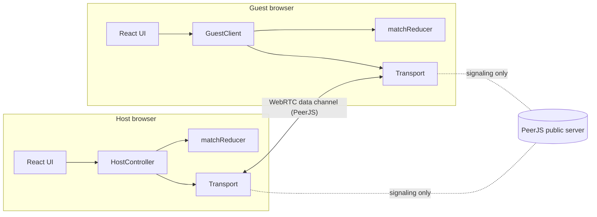

# Duel!

A 1v1 minigame showdown in the browser. One player hits **Quick duel** and shares a 4-letter room code (or link / QR code), a friend punches it in, and they play a best-of-3 or best-of-5 of quick games. No accounts, no install, no game server: the two browsers talk directly over WebRTC.

**Play:** https://esuhail.github.io/duel/

**Same keyboard mode:** two players on one device: Reaction (P1 `A`, P2 `L`) plus every live game below (P1 `WASD`, P2 arrows). It runs the same match reducer with no networking at all.

**Race games** (same puzzle on both screens, best score wins; each has a personal best and a world top 10): Reaction, Quick Math, Target Tap, Anagrams, Memory Sequence, Stop the Clock, Count Flash, Color Clash, Typing Race, Pair Flip, Stacker, Maze Run, Five Letters, Snake Sprint, Word Grid, Whack-a-Mole, Hoop Shot.

**Live games** (you play *against* each other in real time): Light Cycles, Snake Duel, Tug of War, Connect Four, Dots and Boxes, Pong, Jump Rope, Rock Paper Scissors.

Pick which games a match can use with `?games=`, e.g. `https://esuhail.github.io/duel/?games=pong,maze,five`.

## Run it

```bash
npm install
npm run dev            # http://localhost:5173
npm test               # unit + integration tests (Vitest)
npm run test:e2e       # two-browser match in Playwright
```

Open `http://localhost:5173/?net=local` in two tabs to play against yourself without touching the network (the tabs talk over `BroadcastChannel`).

## Architecture



| Layer | File(s) | Job |
| --- | --- | --- |
| Rules | `src/core/match.ts` | Pure reducer `(state, event) => state`. Phases: lobby → countdown → playing → roundResult → matchOver. No I/O, no timers, no randomness. |
| Randomness | `src/core/rng.ts` | mulberry32 seeded RNG, so a seed gives the same puzzle on both devices. |
| Clock sync | `src/core/clock.ts` | Ping/pong offset estimate (Cristian's algorithm) for a synced 3-2-1. |
| Host logic | `src/host/hostController.ts` | Owns the authoritative state, starts rounds, handles rejoin/forfeit timers. Depends only on the `Connection` interface. |
| Guest logic | `src/net/guestClient.ts` | Mirrors state, sends scores, reconnects, measures clock offset. |
| Protocol | `src/net/protocol.ts` | Typed messages + validation of everything the guest sends. |
| Transport | `src/net/*Transport.ts` | `peerjs` (real), `broadcast` (two tabs), `memory` (tests). |
| Games | `src/games/*` | One folder each: a pure `createPuzzle(seed)` and a React component. |

### Key decisions and why

**The host's browser is the server.** Zero hosting cost and no backend to maintain. The host runs the rules and the guest trusts it.

**Event sourcing instead of state syncing.** The host never sends "here is the new state". It sends the *event* (`roundStart`, `score`, ...) that it just applied, and the guest applies the same event to the same reducer. Messages stay tiny, and things like the round result are never sent at all: the guest computes it from the two `score` events, exactly as the host did. A full snapshot (`sync`) is only sent when someone joins or rejoins.

**Same puzzle for both players.** Each round the host picks a seed (derived from one match seed + round + attempt). Both clients build the puzzle from it, play locally, and report one number. Network lag can't affect your score because nothing happens over the network while you play.

**Synced start.** The guest pings the host 5 times, keeps the sample with the smallest round trip, and estimates `offset = hostTime − (t0 + t1) / 2`. The host sends `startAt` in its own clock; the guest converts it to local time. Error is at most half the best round trip (usually under 20 ms).

**Live games use host-driven lockstep.** Race games never talk during play, but live games do. Each live game is a pure `step(state, hostInput, guestInput)` with no randomness, no clock and no floating-point trig, so the same inputs give the same state on both devices. The host runs the tick loop, merges its own input with the guest's latest input, and broadcasts `{tick n, inputs}`. The guest replays exactly those ticks. The host alone decides the winner. Trade-off: the guest sees their own input one round trip late (fine for turn-based games and Light Cycles, noticeable in Pong on a slow connection).

**Games are plugins.** Every game implements one interface (`src/games/types.ts`). Puzzle generation is a separate pure function so determinism is unit-tested per game.

**Disconnects.** A heartbeat in the PeerJS transport detects a vanished peer within ~8 s (WebRTC alone can take much longer). The guest retries the same room every 2 s; the host waits 30 s before the guest forfeits. A guest who rejoins mid-round gets a fresh replay of that round, because their half-played game is gone. A refresh rejoins too: the guest's identity token lives in `sessionStorage`.

## Leaderboard (Supabase, free tier)

Personal bests always work. The world top 10 runs on a free [Supabase](https://supabase.com) project:

1. In the project's **SQL Editor**, run `supabase/schema.sql` (safe to re-run after adding a game).
2. Put the project URL and the `anon` public key in `.env.production`. That key is meant to be public: it ships to every browser. The e2e tests build with `--mode e2e`, which skips that file, so test bots never post scores.

How it's protected: the table is read-only to the public; the only way to write is the `submit_score` function, which rejects impossible scores per game (e.g. a reaction average under 100 ms) and rate-limits by name. Only new personal bests are submitted. Free projects pause after a week with no traffic; opening the dashboard wakes them.

## Sound

All sound effects are synthesised in the browser with the Web Audio API (`src/audio/sfx.ts`): no audio files. They're short and quiet by design, and the Reaction "go" moment is deliberately silent, since we react faster to sound than to light and that would favour the player with audio on.

## Testing

- **Unit** (`*.test.ts`): RNG determinism, every game's puzzle is reproducible from its seed, reducer edge cases (ties, best-of-5 math, late/duplicate/garbage scores, forfeits, rematch, game order with no repeats).
- **Integration** (`src/host/session.test.ts`): real `HostController` + `GuestClient` over the in-memory transport with fake timers: full match, clock sync, third player rejected, drop + rejoin, 30 s forfeit.
- **End to end** (`tests/e2e`): Playwright opens two pages, creates and joins a match over `?net=local`, and bots play every game to the end, then rematch.
- **Manual**: a real match between a phone on cellular data and a laptop on home Wi-Fi (PeerJS path).

## Deploy

Pushing to `main` builds and deploys to GitHub Pages (`.github/workflows/deploy.yml`). One-time setup: repo **Settings → Pages → Source: GitHub Actions**.

Optional usage counting: create a free [GoatCounter](https://www.goatcounter.com) site and add its code as a repository variable `GOATCOUNTER_CODE`. The host reports one `match-complete` event per finished match; no cookies, no personal data.

## License

MIT
